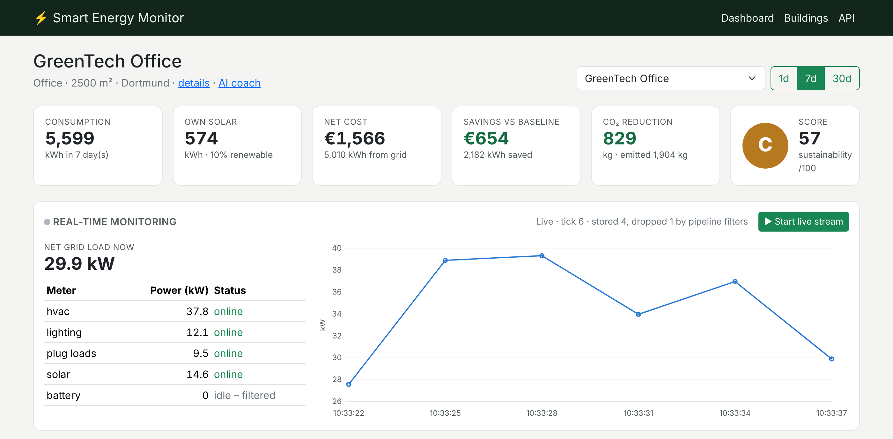
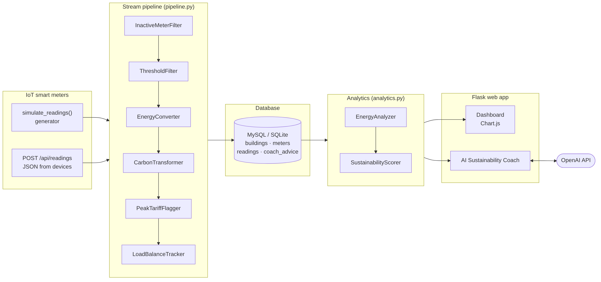
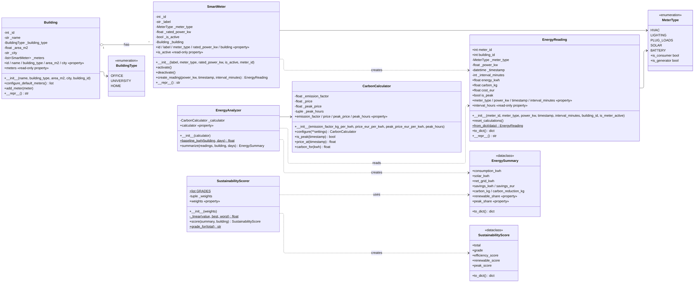
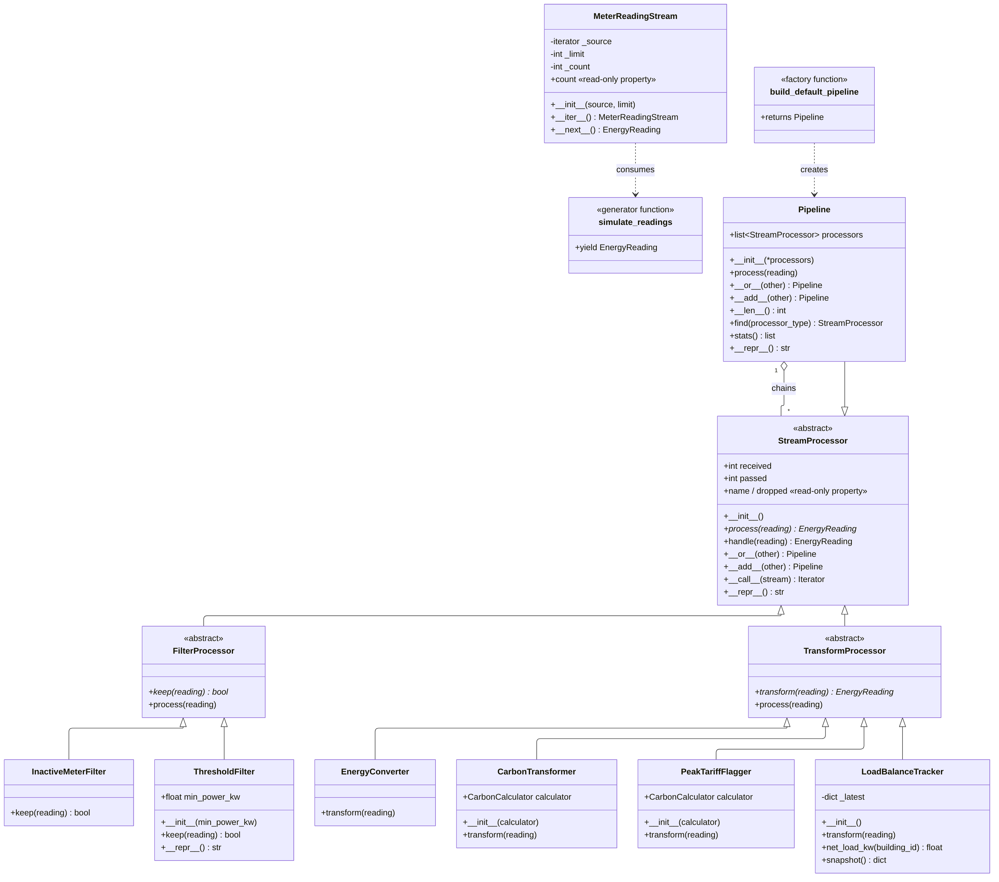
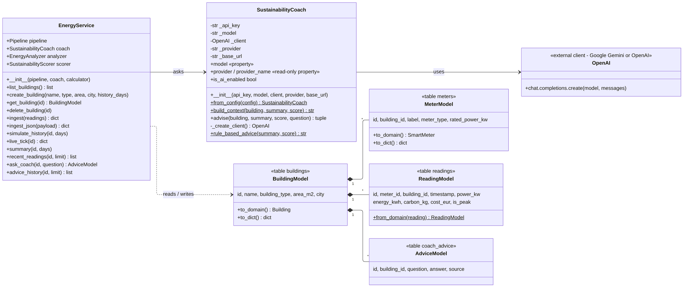
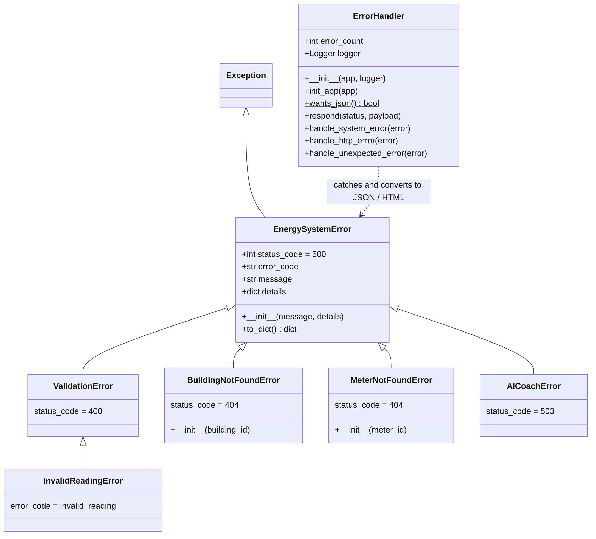
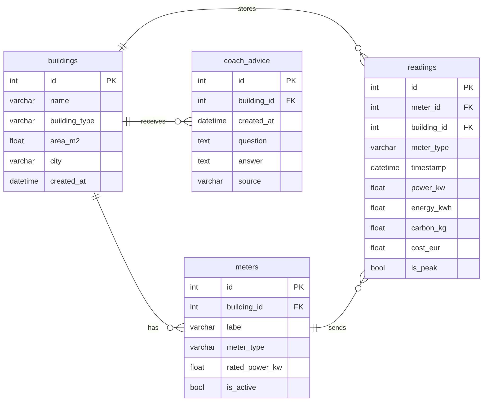

# ⚡ AI-Powered Smart Energy Management System

**Subsystem: Real-Time Energy Monitoring & Sustainability Analytics**

Capstone project – Python course, Fachhochschule Dortmund (Prof. Galyna Tabunshchyk), winter semester 2026/27.

A Flask web application that ingests smart-meter readings from buildings (offices, universities, homes),
processes them in a real-time stream pipeline, stores them in MySQL and shows energy usage, savings,
carbon reduction and a sustainability score on a dashboard. An AI Sustainability Coach (Google Gemini or OpenAI)
turns the numbers into concrete recommendations.

🎥 **Video presentation:** https://youtu.be/068xnKXDZzc
📊 **Slides:** [`docs/presentation/`](docs/presentation/)



---

## Team overview

| Member                               | Role                                     | Subsystem                                              |
| ------------------------------------ | ---------------------------------------- | ------------------------------------------------------ |
| **Nasim Abhari** (matr. no. 7226039) | Developer, architect, tester – all roles | Real-Time Energy Monitoring & Sustainability Analytics |

   > The group originally had four members and four subsystems. After the other members left the course,
   > the professor approved that this project is completed by one student and focuses on one subsystem.

## Features (capstone checklist)

| Checklist item                   | Where                                                                             |
| -------------------------------- | --------------------------------------------------------------------------------- |
| Web interface                    | Flask + Bootstrap: dashboard, buildings, building details, AI coach               |
| Data analysis & visualisation    | `analytics.py` (savings, CO₂, score) + Chart.js charts                            |
| Database storage                 | Flask-SQLAlchemy → **MySQL** (Docker) / SQLite (local)                            |
| AI Sustainability Coach (Gemini / OpenAI) | `coach.py` with rule-based fallback                                      |
| Testing results                  | 40 pytest tests, 93 % coverage → [`docs/test_results.txt`](docs/test_results.txt) |
| Docker                           | `Dockerfile` + `docker-compose.yml` (web + MySQL)                                 |

- **Real-time monitoring** – live stream of meter readings, net grid load updated every 3 seconds
- **Dashboard** – consumption, own solar, cost, savings vs. benchmark baseline, CO₂ reduction (1 / 7 / 30 days)
- **Sustainability score** – 0–100 and grade A–E (efficiency 50 %, renewables 30 %, peak usage 20 %)
- **REST API** for IoT devices – `POST /api/readings`
- **AI Sustainability Coach** – recommendations and free questions, answer history stored in the database

## How to start the project

### Option A – local (easiest, uses SQLite)

```bash
git clone https://github.com/abhnasim/smart-energy-monitor.git
cd smart-energy-monitor
python -m venv .venv
pip install -r requirements.txt
python app.py
```

Open **http://127.0.0.1:5000** – three demo buildings with 7 days of simulated data are created automatically.

### Option B – Docker with MySQL

```bash
docker compose up --build
```

Open **http://localhost:5000**. MySQL runs in its own container (`db`, port 3307).

### Optional: enable the AI coach (OpenAI or Google Gemini)

```bash
cp .env.example .env
```

Then write your key in `.env` (this file is git-ignored):

- **OpenAI:** after `OPENAI_API_KEY=`
- **Google Gemini** (free tier, key from [Google AI Studio](https://aistudio.google.com/apikey)): after `GEMINI_API_KEY=`.
  Gemini is called through its OpenAI-compatible endpoint, so the same OpenAI client is used.
  If a Gemini key is set, it is used instead of OpenAI.

Without a key the coach uses built-in rules, so the app always works.

### Run the tests

```bash
pytest                      # 40 tests
pytest --cov=energy_app     # with coverage (pip install pytest-cov)
```

### Console demos (Hometasks 1 and 2)

```bash
python demo_oop.py          # classes, constructors, getters/setters
python demo_pipeline.py     # stream pipeline with | operator, iterator, generator
```

## System design

### Architecture



### UML class diagram – domain & analytics (Hometask 1)



### UML class diagram – stream pipeline (Hometask 2)



### UML class diagram – web, database & AI coach (Hometask 3)



### UML class diagram – error handling (Hometask 4)



### Database schema



The Mermaid sources of all diagrams are in [`docs/uml/`](docs/uml/).
Requirements (10 functional + 10 non-functional): [`docs/requirements.md`](docs/requirements.md).

## Project structure

```
smart-energy-monitor/
├── app.py                  # starts the web app
├── demo_oop.py             # Hometask 1 console demo
├── demo_pipeline.py        # Hometask 2 console demo
├── energy_app/
│   ├── domain.py           # Building, SmartMeter, EnergyReading        (HA1)
│   ├── analytics.py        # CarbonCalculator, EnergyAnalyzer, Scorer  (HA1)
│   ├── pipeline.py         # ABCs, processors, Pipeline, iterator      (HA2)
│   ├── simulator.py        # IoT meter simulator (generator)           (HA2)
│   ├── models.py           # SQLAlchemy tables                         (HA3)
│   ├── services.py         # EnergyService – application logic         (HA3)
│   ├── coach.py            # AI Sustainability Coach (Gemini / OpenAI) (HA3)
│   ├── routes.py           # Flask pages + JSON API                    (HA3)
│   ├── webapp.py           # Flask application factory                 (HA3)
│   ├── errors.py           # exception classes + ErrorHandler          (HA4)
│   ├── templates/          # Jinja2 HTML pages
│   └── static/             # CSS, JS, bundled Bootstrap + Chart.js
├── tests/                  # 40 pytest tests                           (HA4)
├── docs/                   # UML, requirements, screenshots, test results
├── Dockerfile
├── docker-compose.yml
└── requirements.txt
```

## REST API

| Method | URL                                  | Description                                                    |
| ------ | ------------------------------------ | -------------------------------------------------------------- |
| GET    | `/api/health`                        | health check                                                   |
| GET    | `/api/buildings`                     | all buildings with meters                                      |
| POST   | `/api/buildings`                     | create a building (`name`, `building_type`, `area_m2`, `city`) |
| GET    | `/api/buildings/<id>/summary?days=7` | KPIs + sustainability score                                    |
| POST   | `/api/buildings/<id>/live`           | one real-time tick (used by the dashboard)                     |
| POST   | `/api/readings`                      | ingest readings from IoT meters                                |
| GET    | `/api/pipeline`                      | pipeline statistics                                            |

Example:

```bash
curl -X POST http://127.0.0.1:5000/api/readings \
     -H "Content-Type: application/json" \
     -d '{"meter_id": 1, "power_kw": 42.5}'
```

## Homework branches

| Branch                | Content                                                                                    |
| --------------------- | ------------------------------------------------------------------------------------------ |
| `HomeworkAssignment1`     | OOP classes: constructors, setup methods, getters & setters                                |
| `HomeworkAssignment2` | Real-time stream pipeline: ABCs, inheritance, operator overloading, iterators & generators |
| `HomeworkAssignment3` | Flask web app + MySQL database + AI coach                                                  |
| `HomeworkAssignment4` | Exception handling class + automated tests                                                 |
| `main`                | Final capstone project                                                                     |

## 🛠️ Technologies

Python 3.10+, Flask, Flask-SQLAlchemy, MySQL 8 / SQLite, PyMySQL, OpenAI Python SDK (for Google Gemini and OpenAI), Bootstrap 5, Chart.js 4, pytest, Docker.
